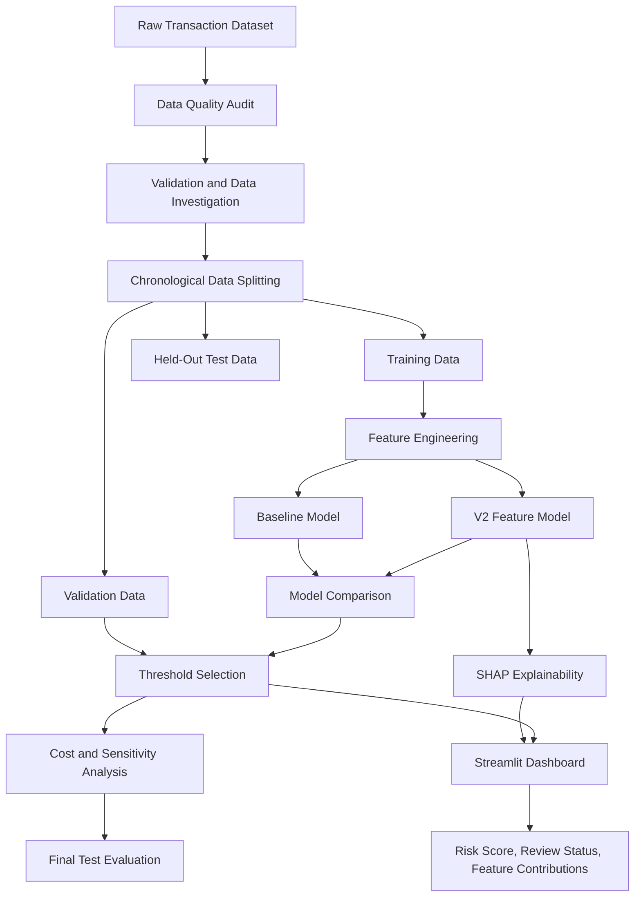

# 🔍 Explainable Fraud Risk Platform
### Cost-Aware Fraud Detection | Explainable AI | Machine Learning | Streamlit

<p align="center">
  <strong>An end-to-end machine learning platform for transaction fraud risk analysis, business-aware decision-making, and explainable predictions.</strong>
</p>

<p align="center">
  
  
  
  
  
  
</p>

---

## 📌 Overview

Financial fraud detection is a challenging machine learning problem. Fraudulent transactions are rare, false-positive alerts consume investigation resources, and missed fraud can result in significant financial losses.

**Explainable Fraud Risk Platform** is an end-to-end machine learning portfolio project designed to explore these challenges through data quality auditing, feature engineering, chronological model evaluation, cost-sensitive threshold selection, and SHAP-based model explanations.

The platform combines a fraud detection workflow with an interactive Streamlit dashboard that allows users to inspect transaction risk scores and understand which features influence individual model outputs.

The project emphasizes not just *whether* a model flags a transaction, but also:

- How reliable the evaluation process is.
- How the selected decision threshold affects alerts.
- How false positives and false negatives influence estimated business costs.
- Which features influence a model's output.
- What limitations must be considered before real-world deployment.

> **Important:** This project uses synthetic transaction data. Its results demonstrate an experimental workflow and must not be interpreted as guaranteed performance on real banking transactions.

## 🎯 Project Objectives

- Build a reproducible transaction fraud analysis workflow.
- Validate data quality before model training.
- Engineer transaction-level risk features.
- Reduce temporal leakage risks through chronological evaluation.
- Compare baseline and engineered-feature models.
- Evaluate precision, recall, alert volume, and estimated business costs.
- Select an operational decision threshold using validation data.
- Explain model outputs using SHAP.
- Present predictions and explanations through an interactive dashboard.
- Apply automated testing to important data and feature engineering components.

## 🏗️ Project Architecture



### Workflow summary

| Stage | Purpose |
|---|---|
| Data auditing | Understand dataset quality, labels, and transaction distributions |
| Validation | Detect missing fields, invalid values, and unsupported transaction types |
| Temporal splitting | Evaluate the model on later transaction periods |
| Feature engineering | Create additional transaction-level risk signals |
| Model development | Train and compare baseline and V2 models |
| Threshold selection | Choose a decision threshold using validation data |
| Cost analysis | Study estimated false-positive and false-negative costs |
| Final evaluation | Measure performance on the held-out test period |
| Explainability | Use SHAP to interpret model outputs |
| Dashboard | Present risk scores and explanations interactively |

## ✨ Key Features

### 1. Data Quality Auditing

The data audit workflow examines:

- Dataset dimensions and column structure.
- Missing values and duplicate records.
- Fraud-label validity.
- Transaction-type distributions.
- Fraud prevalence and class imbalance.
- Balance inconsistencies and potential data quality issues.

The audit is designed to investigate data issues rather than automatically discard every unusual transaction.

### 2. Leakage-Aware Feature Selection

The modeling workflow considers when a feature would be available in a real transaction process.

For the pre-transaction modeling scenario, features that could reveal information unavailable at decision time are excluded from the intended input set.

The target label, `isFraud`, is not used as a predictive feature. Transaction identifiers are also excluded from the intended model inputs.

Feature availability and leakage assumptions remain important limitations that must be reviewed against a real production system.

### 3. Feature Engineering

The feature engineering module in `src/features/engineering.py` creates additional transaction-level signals.

| Feature | Business interpretation |
|---|---|
| `log_amount` | Log-transformed transaction amount |
| `sender_balance_utilization` | Transaction amount relative to the sender's starting balance |
| `receiver_balance_relative_amount` | Transaction amount relative to the receiver's starting balance |
| `sender_balance_insufficient` | Indicator for a transaction amount exceeding the sender's starting balance |

These features help investigate relationships between transaction amounts and available balance information.

### 4. Chronological Model Evaluation

Rather than relying only on a random split, the current workflow separates data according to transaction steps.

| Dataset | Transaction steps | Rows |
|---|---:|---:|
| Training | 1–322 | 4,433,703 |
| Validation | 323–377 | 973,173 |
| Test | 378–743 | 955,744 |
| **Total** | **1–743** | **6,362,620** |

The validation set supports threshold selection, while the held-out test set is used for final evaluation.

Fraud prevalence changes significantly between these periods. This distribution shift is an important part of interpreting model performance.

### 5. Cost-Aware Decision Analysis

A fraud detection system must balance missed fraud against the operational burden of reviewing legitimate transactions.

The project includes:

- Decision threshold comparisons.
- Precision and recall analysis.
- Alert volume analysis.
- False-positive and false-negative cost assumptions.
- Cost sensitivity analysis.
- Model comparison and ablation analysis.
- Transaction-type performance investigation.

The threshold is treated as a business decision, not simply the default value of 0.5.

### 6. SHAP Explainability

The `explainability.py` module supports model interpretation through SHAP.

The explanation workflow investigates:

- Global feature importance.
- Individual transaction explanations.
- Positive and negative feature contributions.
- Feature contributions relative to an explanation background reference.

The dashboard presents readable risk factor names, contribution values, a contribution chart, and a downloadable CSV explanation.

**Interpretation note:** SHAP values explain how features contribute to a model output relative to a reference. They do not establish causal relationships. Contributions shown in log-odds space are not percentage-point changes in fraud probability.

### 7. Interactive Streamlit Dashboard

The application in `app.py` provides a user interface for transaction-level model inspection.

Dashboard capabilities include:

- Transaction input and summary.
- Raw model fraud score.
- Selected decision threshold.
- Review status.
- SHAP-based explanation table.
- Feature contribution visualization.
- CSV download of the explanation.
- Warnings about synthetic-data and model-score limitations.

The dashboard is intended for research, demonstration, and decision-support exploration—not autonomous financial transaction blocking.

## 📊 Dataset

The project uses a PaySim-style synthetic financial transaction dataset.

The audited dataset contains:

| Property | Value |
|---|---:|
| Total transactions | 6,362,620 |
| Number of columns | 11 |
| Fraud-labelled transactions | 8,213 |
| Non-fraud transactions | 6,354,407 |
| Fraud prevalence | Approximately 0.1291% |
| Missing values in the audited dataset | 0 |
| Duplicate rows in the audited dataset | 0 |

### Main columns

| Column | Description |
|---|---|
| `step` | Transaction time step |
| `type` | Transaction category |
| `amount` | Transaction amount |
| `nameOrig` | Originating account identifier |
| `oldbalanceOrg` | Sender's balance before the transaction |
| `newbalanceOrig` | Sender's balance after the transaction |
| `nameDest` | Destination account identifier |
| `oldbalanceDest` | Receiver's balance before the transaction |
| `newbalanceDest` | Receiver's balance after the transaction |
| `isFraud` | Fraud label |
| `isFlaggedFraud` | Dataset-provided fraud flag |

The target variable is `isFraud`.

The dataset's fraud labels, account behavior, and transaction patterns are synthetic. They may contain shortcuts that allow a model to perform unusually well without learning patterns that generalize to real financial institutions.

## 📈 Model Evaluation

The project includes a baseline model and a V2 model with engineered features.

The recorded V2 evaluation on the held-out synthetic test set produced the following results:

| Metric | Recorded result |
|---|---:|
| Average precision (AP) | 0.914594 |
| ROC-AUC | 0.997532 |
| True positives (TP) | 3,263 |
| False positives (FP) | 501 |
| False negatives (FN) | 747 |
| True negatives (TN) | 951,233 |
| Precision | 86.69% |
| Recall | 81.37% |
| Alert rate | 0.3938% |
| Estimated business cost | $114,555 |

These results were recorded using the project's selected threshold of `0.984` and its documented evaluation assumptions.

### How to interpret the results

- **Precision:** Among transactions flagged by the model, the proportion that were fraud-labelled.
- **Recall:** Among fraud-labelled transactions, the proportion detected by the model.
- **Average precision:** A useful summary of precision-recall performance when the positive class is rare.
- **ROC-AUC:** Measures how well the model ranks positive examples above negative examples across thresholds.
- **Alert rate:** The fraction of evaluated transactions flagged for review.
- **Estimated business cost:** A calculation based on the project's assumed costs and evaluation outcomes.

The estimated cost is an experimental business metric, not a measured saving from a live financial institution.

Because the synthetic test period has a different fraud prevalence from the training and validation periods, the reported metrics should be interpreted in that context.

## 🔎 Transaction-Type Analysis

The V2 test evaluation recorded the following results for two transaction types:

| Transaction type | Fraud cases | True positives | False positives | False negatives | Precision | Recall |
|---|---:|---:|---:|---:|---:|---:|
| CASH_OUT | 2,005 | 1,263 | 407 | 742 | 75.63% | 62.99% |
| TRANSFER | 2,005 | 2,000 | 94 | 5 | 95.51% | 99.75% |

These results show that performance differed by transaction type in the synthetic test set.

They should not be generalized to real transaction populations without independent evaluation on representative data.

## 🛠️ Technology Stack

| Technology | Role |
|---|---|
| Python 3.11 | Main programming language |
| pandas | Tabular data processing |
| NumPy | Numerical operations |
| scikit-learn | Preprocessing, modeling, and evaluation |
| SHAP | Model explainability |
| Streamlit | Interactive dashboard |
| pytest | Automated testing |
| Git and GitHub | Version control and project collaboration |

See `requirements.txt` for the project's dependency list.

## 📁 Repository Structure

```text
explainable-fraud-risk-platform/
│
├── app.py
├── explainability.py
│
├── configs/
│   └── model_config.yaml
│
├── data/
│   ├── raw/
│   ├── processed/
│   │   └── splits/
│   └── reference/
│
├── docs/
│
├── models/
│   ├── baseline_model.joblib
│   └── v2_feature_model.joblib
│
├── reports/
│   ├── data_audit.json
│   ├── temporal_split_report.json
│   ├── baseline_model_report.json
│   ├── v1_v2_validation_report.json
│   ├── threshold_selection_report.json
│   ├── cost_sensitivity_report.json
│   ├── final_test_evaluation.csv
│   └── shap_global_importance.csv
│
├── src/
│   ├── data/
│   │   └── validation.py
│   └── features/
│       └── engineering.py
│
├── tests/
│   ├── test_validation.py
│   └── test_feature_engineering.py
│
├── audit_data.py
├── audit_features.py
├── create_temporal_splits.py
├── verify_temporal_splits.py
├── train_baseline.py
├── train_v2_model.py
├── compare_v1_v2.py
├── evaluate_thresholds.py
├── select_operational_threshold.py
├── analyze_cost_sensitivity.py
├── evaluate_final_test.py
├── run_v2_ablation.py
├── compare_rule_vs_v2.py
├── requirements.txt
└── README.md
```

*The tree highlights important files and directories; additional audit and analysis scripts are also included in the repository.*

## 🚀 Installation and Setup

### Prerequisites

- Python 3.11 recommended.
- Git.
- A compatible Windows, macOS, or Linux environment.
- Access to the dataset and required model artifacts.

### 1. Clone the repository

```bash
git clone <YOUR_GITHUB_REPOSITORY_URL>
cd explainable-fraud-risk-platform
```

Replace `<YOUR_GITHUB_REPOSITORY_URL>` with the actual URL of your GitHub repository.

### 2. Create a virtual environment

Windows PowerShell:

```powershell
python -m venv .venv
.\.venv\Scripts\Activate.ps1
```

macOS or Linux:

```bash
python3 -m venv .venv
source .venv/bin/activate
```

### 3. Install dependencies

```bash
python -m pip install -r requirements.txt
```

### 4. Prepare the required artifacts

Ensure the files expected by the application exist in their required locations, including:

- `data/raw/transactions.csv`
- `models/v2_feature_model.joblib`
- Any validation samples or explanation artifacts loaded by the application

These files may not be available after a fresh clone if they are excluded from Git. Use the project's documented artifact setup process, or prepare them locally using the corresponding scripts and configuration.

### 5. Launch the dashboard

```bash
streamlit run app.py
```

Open the local URL printed in the terminal. The default is usually:

```text
http://localhost:8501
```

## 🧪 Run Tests

Run the automated test suite:

```bash
python -m pytest -v
```

The latest recorded test run passed all **14 tests** across data validation and feature engineering.

The suite checks behavior such as:

- Required-column validation.
- Missing-value detection.
- Negative amount rejection.
- Invalid fraud-label detection.
- Unknown transaction-type detection.
- Empty dataset detection.
- Expected engineered feature creation.
- Feature calculation correctness.
- Feature range checks.
- Preservation of the original input DataFrame.

The current tests cover selected components; they do not replace end-to-end testing of the entire application.

## 🧰 Main Analysis Scripts

| Script | Purpose |
|---|---|
| `inspect_data.py` | Inspect the source dataset |
| `audit_data.py` | Run the initial data audit |
| `audit_features.py` | Investigate feature quality and leakage concerns |
| `investigate_balance_mismatches.py` | Analyze balance inconsistencies |
| `create_temporal_splits.py` | Create chronological dataset splits |
| `verify_temporal_splits.py` | Verify split integrity |
| `train_baseline.py` | Train the baseline model |
| `train_v2_model.py` | Train the engineered-feature model |
| `compare_v1_v2.py` | Compare model versions |
| `evaluate_thresholds.py` | Evaluate candidate decision thresholds |
| `select_operational_threshold.py` | Select an operating threshold |
| `analyze_cost_sensitivity.py` | Analyze cost assumptions and sensitivity |
| `evaluate_final_test.py` | Evaluate the selected model on the test period |
| `run_v2_ablation.py` | Investigate feature ablation |
| `compare_rule_vs_v2.py` | Compare a rule-based approach with the V2 model |
| `explainability.py` | Generate SHAP-based explanations |
| `app.py` | Run the interactive dashboard |

## ⚠️ Limitations and Responsible Use

This project is an experimental portfolio prototype, not a production banking system.

### Synthetic data

The dataset does not represent every behavior, fraud strategy, or operational constraint found in real financial institutions.

### Distribution shift

Fraud prevalence changes between the training, validation, and test periods. Performance can change substantially as transaction populations and fraud strategies evolve.

### Score calibration

The displayed model score is a raw model output for the fraud class. It is not guaranteed to represent a calibrated probability of fraud.

### Explainability

SHAP helps interpret model behavior but does not prove causation, guarantee correctness, or eliminate model bias.

### Business cost assumptions

Estimated costs depend on the assumptions used in the analysis. Actual investigation costs and losses vary across institutions and use cases.

### Production readiness

Before any real-world deployment, the system would require representative data, independent validation, score calibration assessment, security and privacy reviews, monitoring, drift detection, human oversight, and appropriate governance.

## 🔮 Future Improvements

- Add verified dashboard screenshots and a demonstration video.
- Expand automated tests to cover the full prediction pipeline.
- Document reproducible model and artifact preparation.
- Evaluate calibration and operational performance under changing fraud prevalence.
- Add model monitoring and data drift detection.
- Evaluate performance on independent, representative datasets.
- Improve deployment, security, and operational monitoring.

## 👨‍💻 Author

**Rauof Qadir**

Software Engineer | Data Science | Machine Learning | Explainable AI


LinkedIn: [!](https://www.linkedin.com/in/rauof-qadir-a68a25338/?isSelfProfile=true)

---

<p align="center">
  <strong>Built to explore the intersection of fraud detection, explainable machine learning, and cost-aware decision-making.</strong>
</p>
